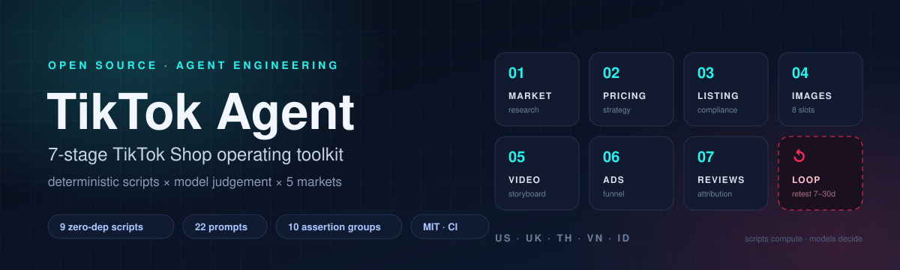
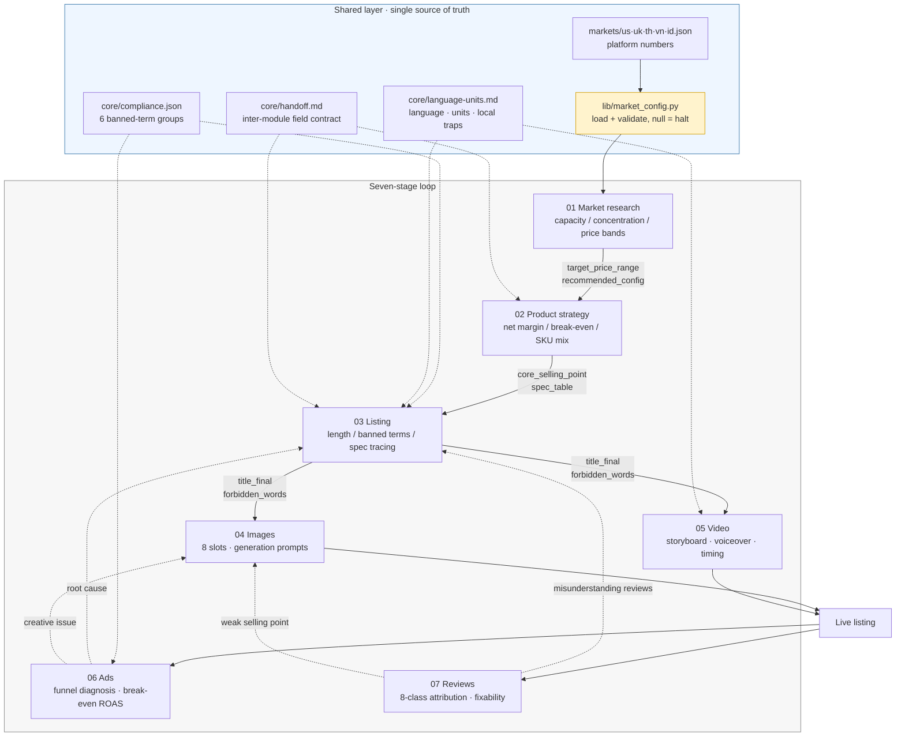

<div align="center">



# TikTok Agent

**A closed-loop operating toolkit for TikTok Shop — seven stages, deterministic arithmetic, model judgement only where it belongs.**

[](https://github.com/feijinloeng/tiktok-agents/actions/workflows/ci.yml)


[English](README.en.md) ｜ [简体中文](README.md) ｜ [Architecture](docs/architecture.md) ｜ [Walkthrough](docs/walkthrough.md) ｜ [Design decisions](docs/design-decisions.md)

</div>

---

> **Agent engineering for real operating workflows**
>
> This repo is more than "letting an LLM write copy". It shows how to turn a multi-stage agent into a testable, reproducible, auditable system:
> what must be delegated to scripts, what may be left to the model, how to pin a data contract between them, and how CI catches the errors.

## 30-second overview

| | |
|---|---|
| **What** | An operating toolkit for TikTok Shop, covering the full loop from category research to listing iteration |
| **Core idea** | Give the arithmetic to scripts, the judgement to the model, and pin a hard data contract between them |
| **Scale** | 7 stages · 5 markets · 9 zero-dependency Python scripts · 22 task prompts · 7 input templates · 10 assertion groups |
| **Stack** | Python 3.9+ (stdlib only) · Markdown-as-code · Mermaid · GitHub Actions · JSON as single source of truth |
| **Run it** | `git clone` → `make test`, no third-party packages |
| **Use cases** | TikTok Shop operations, cross-border sourcing & pricing, content compliance |

### Suggested reading path

| Time | Read |
|---|---|
| 30 s | The architecture diagram and the "engineering highlights" table below |
| 3 min | "Three non-negotiables" + "The seven stages" |
| 10 min | [docs/design-decisions.md](docs/design-decisions.md): 13 trade-offs and the incidents each one prevents |
| Want code | `make test` and watch the 10 assertion groups pass |

---

## Architecture



### Layers

| Layer | Directory | Responsibility | Why it is separate |
|---|---|---|---|
| **Entry** | `SKILL.md` / `runbook.md` | routing + three non-negotiables + per-step stop conditions | one place for humans and agents to start |
| **Rules** | `core/` | banned terms, language & units, inter-module field contract | change a rule once, not in three prompts |
| **Data** | `markets/` + `lib/` | platform numbers for five markets + validation | numbers decoupled from code; `null` = unverified = halt |
| **Execution** | `modules/01…07` | `SKILL.md` + `prompts/` + `scripts/` + `templates/` | identical shape, independently runnable and testable |
| **Verification** | `tests/` + `.github/workflows/` | 10 assertion groups + CI on three Python versions | exit code is the verdict, not eyeballing |

**Dependencies only point down**: execution may read rules and data, rules depend on nothing. Changing one market number touches zero scripts.

### Tech stack

| Category | Choice | Note |
|---|---|---|
| Language | Python 3.9+ | stdlib only; `git clone` and run |
| Agent shape | Markdown `SKILL.md` + task prompts | model-agnostic: Claude / Codex / GPT all work |
| Architecture | layered pipeline + data contracts + stop conditions | scripts compute, the model interprets |
| Config | JSON (`markets/`, `core/`) | single source of truth; `null` is an explicit halt signal |
| Visualisation | Mermaid | architecture and sequence diagrams versioned with the code |
| CI | GitHub Actions | Python 3.9 / 3.11 / 3.13 |
| Tests | self-contained assertion script | zero dependencies, 10 groups, covers every money path and every error path |

---

## Engineering highlights

| Highlight | How | Where |
|---|---|---|
| **Layered agent design** | every stage ships the same four pieces: entry `SKILL.md`, `prompts/`, deterministic `scripts/`, input `templates/` | [modules/](modules/) |
| **Contract-driven** | `core/handoff.md` pins ownership of `spec_table` / `core_selling_point`; downstream may not rewrite them | [core/handoff.md](core/handoff.md) |
| **Single source of truth** | platform numbers only in `markets/`, banned terms only in `core/compliance.json` | [core/compliance.json](core/compliance.json) |
| **Defensive data pipeline** | ambiguous numbers refused; low column coverage reports "not computable" | [stage 01 scripts](modules/01-market-research/scripts/) |
| **Quality gate** | non-zero exit = failure; CI runs 10 assertion groups on three versions | [tests/run_asserts.py](tests/run_asserts.py) |
| **Closed-loop feedback** | ads / reviews feed back into 03 / 04; one root cause per round; retest windows fixed | [runbook.md](runbook.md) |

---

## Three non-negotiables

These are architectural constraints, defined once in [SKILL.md](SKILL.md) and inherited by every module.

### 1. Never guess a number — `null` is a stop signal

Platform numbers (title character cap, required certifications, settlement currency) live **only** in `markets/<market>.json`. They are never copied into a prompt or a script.

`null` in config means *unverified*. Any script that reads `null` raises `[UNVERIFIED]` and exits non-zero — **substituting a default is forbidden**:

```
$ python3 lib/market_config.py --check
✅ id   USD  ready
✅ th   USD  ready
✅ uk   USD  ready
✅ us   USD  ready
✅ vn   USD  ready

All markets ready.
```

The trade-off is friction. The payoff is that **no number in the output is invented**.

### 2. Never let the model do arithmetic

Pricing, break-even, title length, voiceover timing, concentration shares — all executed by scripts.

Pricing keeps four formulas in code ([`sku_pricing.py`](modules/02-product-strategy/scripts/sku_pricing.py)):

```
pre-ad margin  = price − landed cost − price × (referral + payment + affiliate + return + tax)
net margin     = (pre-ad margin − price × ad%) ÷ price
break-even     = cost ÷ (1 − total fee %)
target price   = cost ÷ (1 − total fee % − ad% − target net margin %)
```

Referral and payment rates are deliberately **not** in config — they vary by category and by creator. The script refuses to run without them:

```
$ sku_pricing.py calc --market us --cost 5 --price 20
[INPUT_MISSING] missing --referral-pct ... this rate differs per category; the script will not guess.
```

### 3. Buyer-facing text in the market's language, every number traceable

Titles, descriptions, in-image copy and subtitles are written in the buyer's language (`en-US` / `en-GB` / `th-TH` / `vi-VN` / `id-ID`); internal notes stay in Chinese.

Every digit shown to a buyer must trace back to a single `spec_table`, character for character. [`spec_consistency.py`](modules/03-listing/scripts/spec_consistency.py) enforces it:

```
$ python3 modules/03-listing/scripts/spec_consistency.py --spec spec.csv --text description.txt
❌ "Potencia 45 km"  ← spec says W, copy says km (unit mismatch)
exit 1
```

---

## The seven stages

Every stage has an identical layout: `SKILL.md` (entry point + stop conditions), `prompts/` (task prompts), `scripts/` (deterministic arithmetic), `templates/` (input templates).

| # | Stage | Input → output | Scripts | Stop condition |
|---|---|---|---|---|
| 01 | [Market research](modules/01-market-research/SKILL.md) | category export CSV → capacity / concentration / price bands / config crosstab | `category_parser`<br/>`market_metrics` | sample < 30 → no percentage claims; brand column < 50% populated → concentration is "not computable" |
| 02 | [Product strategy & pricing](modules/02-product-strategy/SKILL.md) | cost structure + fee rates → net margin / break-even / target price / promo headroom / break-even ROAS | `sku_pricing` | no `decision_approved` → no SKU plan; fee rates must be supplied per call |
| 03 | [Listing & compliance](modules/03-listing/SKILL.md) | `spec_table` + selling points → 2–3 title variants + description + banned-term list | `title_lint`<br/>`compliance_scan`<br/>`spec_consistency` | any non-zero exit blocks delivery; unit mismatch is a failure |
| 04 | [Product images](modules/04-images/SKILL.md) | `spec_table` + package contents → 8-slot plan + 7-section generation prompts | — (TikTok imposes no hard image spec) | in-image numbers must equal `spec_table` character for character; certification marks only from `certifications` |
| 05 | [Short video](modules/05-video/SKILL.md) | selling points + target duration → script / storyboard / voiceover / subtitles | `video_timing` | voiceover over `target × 0.8` → cut words, **never speed up delivery** |
| 06 | [Ad diagnosis](modules/06-ads/SKILL.md) | ad export CSV + costs → funnel localization + P0/P1/P2 actions | `ad_metrics` | impressions < 1000 → no action; **no bid advice when the upper funnel already fails** |
| 07 | [Review feedback](modules/07-reviews/SKILL.md) | review CSV (model-labelled) → 8-class attribution / fixability / selling-point ranking | `review_stats` | attribution sum ≠ negative-review count → fix data first; < 20 reviews → reference only |

> Every `SKILL.md` ends with explicit **stop conditions**. If they are not met, stop — do not push through. This is the least intuitive and most money-saving rule in the pipeline.

### Loop discipline

Change one root cause at a time; state what you are deliberately *not* touching this round; retest after 7 days for ads and 14–30 days for copy; when a target is missed, **do not double down on the same action** — go back to diagnosis.

---

## Quick start

Zero dependencies. Python 3.9+. No install step.

```bash
git clone https://github.com/feijinloeng/tiktok-agents.git
cd tiktok-agents

make check     # are the market configs complete?
make test      # regression assertions (10 groups)
```

Without `make`:

```bash
python3 lib/market_config.py --check
python3 tests/run_asserts.py
```

Expected output:

```
[1] Number parsing: no guessing on ambiguity
  ✅ sample CSV parsed
  ✅ 50/50 rows preserved
  ✅ ambiguous number → non-zero exit
[3] Pricing: affiliate commission included + math correct
  ✅ total fee = 6+2+15+2 = 25%
  ✅ pre-ad margin = 39.99-12-10.00 = 17.99
  ✅ break-even = 12/0.75 = 16.00
...
====================================================
✅ all passed
```

### Run a real slice of the pipeline

```bash
# 01 parse a category export → normalised JSON
python3 modules/01-market-research/scripts/category_parser.py \
    tests/fixtures/parse-fixture.csv --number-locale us -o /tmp/data.json

# 01 compute metrics
python3 modules/01-market-research/scripts/market_metrics.py \
    /tmp/data.json --top 5 --currency USD --format md

# 02 pricing (fill your category's rates)
python3 modules/02-product-strategy/scripts/sku_pricing.py calc \
    --market us --cost 12 --price 39.99 \
    --referral-pct 6 --payment-pct 2 --affiliate-pct 15 --return-pct 2

# 03 title / compliance / spec tracing
python3 modules/03-listing/scripts/title_lint.py \
    "20000mAh Power Bank 45W USB-C 3 Ports LED Display" --market us
python3 modules/03-listing/scripts/compliance_scan.py \
    --market us --title "The Best Power Bank, Free Shipping"

# 06 ad diagnosis
python3 modules/06-ads/scripts/ad_metrics.py calc \
    --market us --price 39.99 --product-cost 12 --shipping 4 \
    --referral-pct 6 --payment-pct 2
```

A full end-to-end run with real output: **[docs/walkthrough.md](docs/walkthrough.md)**.

---

## Engineering notes

### Refusing to parse ambiguous numbers

Category exports mix `1,299.00` and `1.299,00` — visually similar, opposite meaning. The parser **refuses to guess**:

```
ParserError: ambiguous number '20.000' in the price column — could be 20.000 (thousands)
             or 20.000 (decimal). Re-run with --number-locale us|eu.
```

Each market declares its `number_locale` in `markets/<m>.json`; scripts follow config, not heuristics.

### Concentration metrics don't flatter you

With only 30% of the brand column populated, computing HHI produces a confident "highly fragmented market" conclusion. `market_metrics.py` checks coverage first:

```
brand column coverage 33% (< 50%) → concentration: not computable
```

### Spec tracing runs in both directions

`spec_consistency.py` checks not only "is every number in the copy traceable to spec" but also "does a spec value never appear in the copy" — the latter means **a key spec was never communicated**, a common conversion leak.

### Funnel discipline is enforced in the exit code

When CTR fails, `ad_metrics.py` produces **no bid or budget recommendation at all** — only upper-funnel creative actions. This is a hard rule with a dedicated assertion:

```
[8] Ads: failing upper funnel must not yield bid advice
  ✅ low CTR → creative actions suggested
  ✅ low CTR → no bid adjustment emitted
```

### Four real differences between TikTok and legacy platforms

This repo was migrated from another platform; every discovered difference became code:

| Item | Legacy platform | TikTok Shop | How it shows up in code |
|---|---|---|---|
| Product images | white background + min size enforced | **no size, no background, text allowed on main image** | module 04 ships **no script** — planning only |
| Video | duration / subtitle length / speech rate capped | **none capped** | `video_timing.py` estimates only; `--target` never returns pass/fail |
| Settlement currency | local currency per site | **USD everywhere** | all five configs set `currency: USD` |
| Fee rates | fixed per category | category + creator, both floating | rates **excluded from config**, demanded per call |

---

## Repository layout

```
.
├── SKILL.md                    # entry point: routing table + three non-negotiables
├── runbook.md                  # per-step inputs, commands, stop conditions
├── STATUS.md                   # readiness matrix per stage
├── core/                       # rules (single source of truth)
│   ├── compliance.json         #   6 banned-term groups
│   ├── language-units.md       #   language / units / local traps per market
│   └── handoff.md              #   inter-module field contract
├── markets/                    # platform numbers (single source of truth)
│   ├── us.json  uk.json  th.json  vn.json  id.json
├── lib/
│   └── market_config.py        # config loading + validation (--check)
├── modules/
│   ├── 01-market-research/     #   ├─ SKILL.md    entry + stop conditions
│   ├── 02-product-strategy/    #   ├─ prompts/    task prompts
│   ├── 03-listing/             #   ├─ scripts/    deterministic arithmetic
│   ├── 04-images/              #   └─ templates/  input templates
│   ├── 05-video/
│   ├── 06-ads/
│   └── 07-reviews/
├── tests/
│   ├── run_asserts.py          # 10 assertion groups, zero dependencies
│   └── fixtures/               # sample deliberately mixing us/eu number formats
└── docs/
    ├── architecture.md         # layering and data flow
    ├── walkthrough.md          # end-to-end run log
    └── design-decisions.md     # key trade-offs and the incidents behind them
```

**Scale**: ~8k lines · 9 Python scripts · 22 task prompts · 7 input templates · 10 assertion groups · 0 third-party dependencies.

---

## Inter-module contract

The classic multi-stage failure is "upstream signed off on 200 kg, downstream shipped 150 kg". `core/handoff.md` pins field ownership:

| Field | Produced by | Consumed by | Rule |
|---|---|---|---|
| `spec_table` | **human input** | everything | single numeric source, character-for-character |
| `core_selling_point` | **stage 02** | 03 / 04 / 05 | exactly one; **03 may not rewrite it**, only decompose it into title terms / main-image copy / video hook |
| `forbidden_words[]` | stage 03 (compliance scan) | 04 / 05 | hard block downstream, no local relaxation |

Why does the selling point belong to 02 rather than 03? **A selling point is a product decision (spec vs competitor), not a copy decision.** Assigning it to 03 lets the copywriter decide what the product is.

If 03 finds a conflict between the selling point and `spec_table`, it **stops and reports** — it never adjusts the spec.

---

## Quality

| Mechanism | Detail |
|---|---|
| Regression assertions | `tests/run_asserts.py`, 10 groups, covering every path that computes money or waves an error through |
| Exit-code contract | non-zero = failure, directly CI-usable |
| Single source | banned terms only in `compliance.json`; platform numbers only in `markets/` — one edit per rule change |
| Deliberately dirty fixtures | `tests/fixtures/parse-fixture.csv` mixes `1,299.00` with `1.299,00` to exercise ambiguity handling |
| CI | GitHub Actions, Python 3.9 / 3.11 / 3.13 in parallel |

The ten groups: `[1]` ambiguous-number parsing · `[2]` unverified config refuses to run · `[3]` pricing math with affiliate commission · `[4]` single banned-term source · `[5]` title length and banned terms · `[6]` spec consistency including units · `[7]` metrics `--top` and missing columns · `[8]` failing upper funnel emits no bid advice · `[9]` zero-negative-review input does not crash · `[10]` video estimates without enforcing limits

---

## Explicit non-goals

- No platform API integration, no seller-backend automation, no price changes, no review replies
- No fake orders, fake reviews, mass reporting, or review-removal inducement
- No data collection — exports are supplied by the operator
- No review authenticity judgement, no competitor copy-pasting

AI-generated or materially edited visuals and voiceovers must carry the platform's native disclosure; platform watermarks and AI labels must not be removed.

---

## Status

See [STATUS.md](STATUS.md). Scripts, SKILL and prompts for all seven stages are TikTok-native.

**The only thing the operator maintains**: per-category referral and payment rates — the scripts demand them on every call.

## Documentation index

| Document | Contents |
|---|---|
| [runbook.md](runbook.md) | one pipeline from zero to live: inputs, commands, stop conditions per step |
| [docs/architecture.md](docs/architecture.md) | layering, data flow, why the cut is where it is |
| [docs/walkthrough.md](docs/walkthrough.md) | a Power Bank SKU through all seven stages, with real output |
| [docs/design-decisions.md](docs/design-decisions.md) | 13 trade-offs and the incidents each one prevents |
| [core/handoff.md](core/handoff.md) | inter-module field contract |
| [core/language-units.md](core/language-units.md) | per-market language and unit strategy |
| [CONTRIBUTING.md](CONTRIBUTING.md) | how to add a market or a stage |
| [CHANGELOG.md](CHANGELOG.md) | release history |
| [LICENSE](LICENSE) | MIT |

---

<div align="center">

MIT License · built with the help of Claude / Codex agents

</div>
