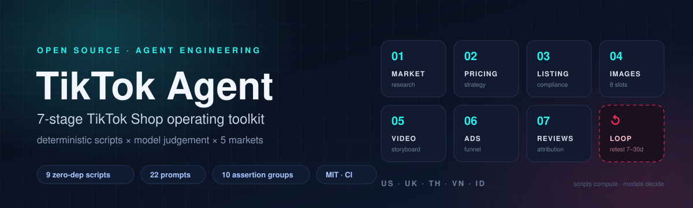
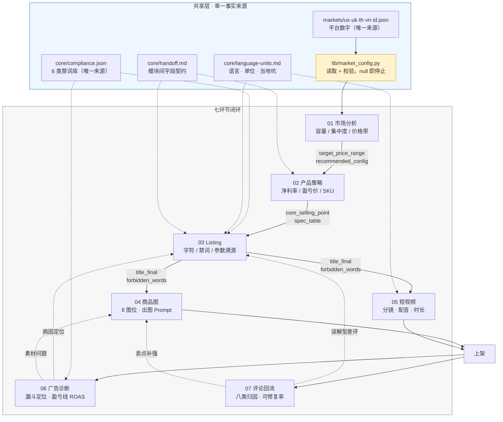

<div align="center">



# TikTok Agent

**TikTok Shop 跨境运营 Agent 工具箱 · 七环节闭环 · 确定性算术 + 模型判断**

[](https://github.com/feijinloeng/tiktok-agents/actions/workflows/ci.yml)


[简体中文](README.md) ｜ [English](README.en.md) ｜ [架构](docs/architecture.md) ｜ [实跑记录](docs/walkthrough.md) ｜ [设计决策](docs/design-decisions.md)

</div>

---

> **面向真实运营场景的 Agent 工程实践**
>
> 这个仓库不只演示「让大模型写文案」，而是把多环节 Agent 做成可测试、可复现、可审计的系统：
> 哪些活必须交给脚本、哪些活才留给模型、两者之间如何定死数据契约、错误如何在 CI 里被拦住。

## 30 秒看懂

| | |
|---|---|
| **是什么** | 面向 TikTok Shop 的运营 Agent 工具箱，覆盖选品 → 定价 → Listing → 图 / 视频 → 广告 → 评论的完整闭环 |
| **核心主张** | 把会算错的活交给脚本，把需要判断的活留给模型，两者之间定死数据契约 |
| **规模** | 7 个环节 · 5 个市场 · 9 个零依赖 Python 脚本 · 22 个任务 Prompt · 7 个输入模板 · 10 组回归断言 |
| **技术栈** | Python 3.9+（纯标准库）· Markdown-as-code · Mermaid · GitHub Actions · JSON 单一事实来源 |
| **怎么跑** | `git clone` → `make test`，不装任何第三方包 |
| **适用场景** | TikTok Shop 运营、跨境选品与定价、内容合规检查 |

### 建议阅读路线

| 时间 | 看什么 |
|---|---|
| 30 秒 | 下面的架构图 + 「工程亮点」表 |
| 3 分钟 | 「三条底线」+「七个环节」表 |
| 10 分钟 | [docs/design-decisions.md](docs/design-decisions.md)：13 条取舍与它们各自防住的事故 |
| 想跑代码 | `make test`，看 10 组断言全部通过 |

---

## 技术架构



### 分层结构

| 层 | 目录 | 职责 | 为什么单独一层 |
|---|---|---|---|
| **入口层** | `SKILL.md` / `runbook.md` | 路由 + 三条底线 + 每步停止条件 | 人和 Agent 都从这里进，规则只写一次 |
| **规则层** | `core/` | 禁词库、语言与单位、模块间字段契约 | 规则变了只改一处，不会在 prompt 里各抄一份 |
| **数据层** | `markets/` + `lib/` | 5 个市场的平台数字 + 配置校验 | 数字与代码解耦，`null` = 未核实 = 停止 |
| **执行层** | `modules/01…07` | `SKILL.md` + `prompts/` + `scripts/` + `templates/` | 每个环节结构一致，可单独跑、可单独测 |
| **验证层** | `tests/` + `.github/workflows/` | 10 组断言 + 三版本 Python CI | 退出码即结论，不靠人肉眼检查 |

**依赖方向严格向下**：执行层可以读规则层和数据层，规则层不依赖任何东西。所以改一个市场数字，不需要动任何脚本。

### 技术栈

| 类别 | 选型 | 说明 |
|---|---|---|
| 语言 | Python 3.9+ | 只用标准库，`git clone` 即可跑 |
| Agent 形态 | Markdown `SKILL.md` + 任务 Prompt | 不绑定具体模型，Claude / Codex / GPT 均可执行 |
| 架构模式 | 分层管道 + 数据契约 + 停止条件 | 脚本负责算术，模型只做解释 |
| 配置 | JSON（`markets/`、`core/`） | 单一事实来源，`null` 是显式停止信号 |
| 可视化 | Mermaid | 架构图 / 时序图随代码一起版本化 |
| CI | GitHub Actions | Python 3.9 / 3.11 / 3.13 三个版本 |
| 测试 | 自带断言脚本 | 零依赖，10 组，覆盖所有会算钱和会放过错误的路径 |

---

## 工程亮点

| 亮点 | 怎么做的 | 在哪能看到 |
|---|---|---|
| **分层 Agent 架构** | 每个环节固定四件套：入口 `SKILL.md`、任务 `prompts/`、确定性 `scripts/`、输入 `templates/` | [modules/](modules/) |
| **契约驱动** | `core/handoff.md` 钉死 `spec_table` / `core_selling_point` 的归属，下游不得改写 | [core/handoff.md](core/handoff.md) |
| **单一事实来源** | 平台数字只在 `markets/`，禁词只在 `core/compliance.json` | [core/compliance.json](core/compliance.json) |
| **防御式数据管道** | 歧义数字拒绝解析；品牌列覆盖率不足直接报「不可计算」 | [01 脚本](modules/01-market-research/scripts/) |
| **质量门禁** | 脚本非零退出 = 不合格；CI 三版本跑 10 组断言 | [tests/run_asserts.py](tests/run_asserts.py) |
| **闭环反馈** | 广告 / 评论回流到 03 / 04，一次只改一个病因，复测周期写死 | [runbook.md](runbook.md) |

---

## 三条底线

这是整个仓库的架构约束，任何模块都继承，在 [SKILL.md](SKILL.md) 里定义一次，全仓复用。

### 1. 数字不猜 —— `null` 就是停止信号

平台数字（标题字符上限、认证要求、结算币种）只写在 `markets/<market>.json`，**不写进 prompt，不写进脚本**。

配置里 `null` = 未核实。任何脚本读到 `null` 立刻抛 `[UNVERIFIED]` 并退出非零，**不许用默认值顶替**：

```
$ python3 lib/market_config.py --check
✅ id   USD  可以跑
✅ th   USD  可以跑
✅ uk   USD  可以跑
✅ us   USD  可以跑
✅ vn   USD  可以跑

全部市场就绪。
```

代价是「不方便」，收益是**没有一个数字是编的**。运营数据造假，比写不出文案严重得多。

### 2. 算的不交给模型

定价、盈亏线、标题字符数、口播时长、集中度占比，一律跑脚本。

以定价为例，四个公式都钉在脚本里（[`modules/02-product-strategy/scripts/sku_pricing.py`](modules/02-product-strategy/scripts/sku_pricing.py)）：

```
广告前毛利 = 售价 − 到岸成本 − 售价 × (referral + payment + affiliate + 退货 + 税)
净利率     = (广告前毛利 − 售价 × 广告%) ÷ 售价
盈亏价     = 成本 ÷ (1 − 费率合计%)
目标价     = 成本 ÷ (1 − 费率合计% − 广告% − 目标净利%)
```

而且 **佣金率、支付费率不进配置文件** —— 它们按类目、按达人浮动，脚本不猜，缺了直接拒绝执行：

```
$ python3 modules/02-product-strategy/scripts/sku_pricing.py calc --market us --cost 5 --price 20
[INPUT_MISSING] 缺 --referral-pct ... 这类目费率每个都不同，脚本不猜。
```

### 3. 买家可见文本 = 目标市场语言，数值必须溯源

标题、详情、图内文字、字幕用买家语言（`en-US` / `en-GB` / `th-TH` / `vi-VN` / `id-ID`），内部备注用中文。

所有出现的数字必须能溯源到同一份 `spec_table`，逐字符一致。由 [`spec_consistency.py`](modules/03-listing/scripts/spec_consistency.py) 机器校验：

```
$ python3 modules/03-listing/scripts/spec_consistency.py --spec spec.csv --text 详情.txt
❌ Potencia 45 km  ← spec 里是 W，文案写成 km（单位不符）
退出码 1
```

---

## 七个环节

每个环节结构完全一致：`SKILL.md`（入口与停止条件）+ `prompts/`（任务 Prompt）+ `scripts/`（确定性算术）+ `templates/`（输入模板）。

| # | 环节 | 输入 → 产物 | 脚本 | 停止条件 |
|---|---|---|---|---|
| 01 | [市场分析](modules/01-market-research/SKILL.md) | 类目导出 CSV → 容量 / 集中度 / 价格带 / 配置交叉表 | `category_parser`<br/>`market_metrics` | 样本 < 30 不出百分比；品牌列覆盖率 < 50% 集中度报「不可计算」 |
| 02 | [产品策略与定价](modules/02-product-strategy/SKILL.md) | 成本结构 + 费率 → 净利率 / 盈亏价 / 目标价 / 促销余量 / 盈亏线 ROAS | `sku_pricing` | 缺 `decision_approved` 不做规格化；佣金费率必须当场填 |
| 03 | [Listing 与合规](modules/03-listing/SKILL.md) | `spec_table` + 卖点 → 标题 2–3 版 + 详情 + 禁词清单 | `title_lint`<br/>`compliance_scan`<br/>`spec_consistency` | 三个脚本任一非零退出即不得交付；单位不符也算失败 |
| 04 | [商品图](modules/04-images/SKILL.md) | `spec_table` + 包装清单 → 8 图位规划 + 七槽位出图 Prompt | — （TikTok 无硬性图片规格） | 图内数字必须逐字符等于 `spec_table`；认证标志只能来自 `certifications` |
| 05 | [短视频](modules/05-video/SKILL.md) | 卖点 + 目标时长 → 脚本 / 分镜 / 配音稿 / 字幕 | `video_timing` | 口播超「目标时长 × 0.8」→ 删词，**不许加语速** |
| 06 | [广告诊断](modules/06-ads/SKILL.md) | 广告导出 CSV + 成本 → 漏斗定位 + P0/P1/P2 动作 | `ad_metrics` | 曝光 < 1000 不动；**前段不达标时不出出价建议** |
| 07 | [评论回流](modules/07-reviews/SKILL.md) | 评论 CSV（模型打标）→ 八类归因 / 可修复率 / 卖点排行 | `review_stats` | 归因合计 ≠ 差评数先修数据；< 20 条只作参考 |

> 每个 `SKILL.md` 都有明确的「**停止条件**」。不满足就停，不往下硬推 —— 这是这套流程里最反直觉、也最省钱的一条。

### 闭环纪律

一次只改一个病因；每轮写明「本轮明确不动」；复测周期广告 7 天、文案 14–30 天；未达标**不加码同一动作**，回诊断重新定位。

---

## 快速开始

零依赖，Python 3.9+，不装任何包就能跑。

```bash
git clone https://github.com/feijinloeng/tiktok-agents.git
cd tiktok-agents

make check     # 市场配置是否填满
make test      # 脚本层回归（10 组断言）
```

不用 `make` 也可以：

```bash
python3 lib/market_config.py --check
python3 tests/run_asserts.py
```

`tests/run_asserts.py` 会输出：

```
[1] 数字解析：歧义不猜
  ✅ 样例 CSV 解析成功
  ✅ 50/50 行不丢
  ✅ 歧义数字 → 非零退出
[3] 定价：达人佣金计入 + 数学正确
  ✅ 费率合计 = 6+2+15+2 = 25%
  ✅ 广告前毛利 = 39.99-12-10.00 = 17.99
  ✅ 盈亏价 = 12/0.75 = 16.00
...
====================================================
✅ 全部通过
```

### 跑一遍真实链路

```bash
# 01 解析类目导出 → 标准化 JSON
python3 modules/01-market-research/scripts/category_parser.py \
    tests/fixtures/parse-fixture.csv --number-locale us -o /tmp/data.json

# 01 算指标
python3 modules/01-market-research/scripts/market_metrics.py \
    /tmp/data.json --top 5 --currency USD --format md

# 02 定价（费率按你的类目填）
python3 modules/02-product-strategy/scripts/sku_pricing.py calc \
    --market us --cost 12 --price 39.99 \
    --referral-pct 6 --payment-pct 2 --affiliate-pct 15 --return-pct 2

# 03 标题 / 合规 / 参数溯源
python3 modules/03-listing/scripts/title_lint.py \
    "20000mAh Power Bank 45W USB-C 3 Ports LED Display" --market us
python3 modules/03-listing/scripts/compliance_scan.py \
    --market us --title "The Best Power Bank, Free Shipping"

# 06 广告诊断
python3 modules/06-ads/scripts/ad_metrics.py calc \
    --market us --price 39.99 --product-cost 12 --shipping 4 \
    --referral-pct 6 --payment-pct 2
```

完整跑例（含真实输出与踩坑记录）见 **[docs/walkthrough.md](docs/walkthrough.md)**。

---

## 工程细节

### 数据进不来就不猜：`--number-locale`

类目导出里 `1.299,00` 和 `1,299.00` 长得像，含义相反。解析器**拒绝猜**：

```
ParserError: 价格列存在歧义数字 '20.000' —— 可能是 20.000（千分位）或 20.000（小数）。
             请用 --number-locale us|eu 指定口径后重跑。
```

5 个市场各自在 `markets/<m>.json` 里声明 `number_locale`（`us` 用 `1,234.56`，`eu` 用 `1.234,56`），脚本按配置走。

### 集中度不撒糖：覆盖率不足就报「不可计算」

品牌列只有 30% 有值时，直接算 HHI 会得出「市场高度分散」的假结论。`market_metrics.py` 先查覆盖率：

```
品牌列有值覆盖 33% (< 50%) → 集中度：不可计算
```

### 参数溯源反向也查

`spec_consistency.py` 不只查「文案里的数字是否在 spec 里」，还反向查「spec 里的数字是否一次都没在文案出现」—— 后者说明**参数没讲**，是转化率损失的常见原因。

### 漏斗纪律写进退出码

`ad_metrics.py` 在 CTR 不达标时，**不会输出任何出价/预算建议**，只给「回流素材层」的动作。这是硬规则，有对应断言：

```
[8] 广告：前段不达标不许调出价
  ✅ 低 CTR 时给出回流素材
  ✅ 低 CTR 时不出价调整指令
```

### TikTok 与老平台的四个真实差异

这个仓库从别的平台迁移过来，迁移中发现的不一样，全部落进了代码：

| 项 | 老平台 | TikTok Shop | 代码里怎么体现 |
|---|---|---|---|
| 商品图 | 强制白底 + 最小尺寸 | **不限尺寸、不限背景、主图可带字** | 04 模块**没有脚本**，只做规划 |
| 视频 | 限时长 / 字幕字数 / 语速 | **全不限** | `video_timing.py` 只估算，`--target` 不判合格 |
| 结算币种 | 按站点当地货币 | **统一 USD** | 5 份配置 `currency` 全为 `USD` |
| 费率 | 固定类目费率 | 类目 + 达人双重浮动 | 费率**不进配置**，每次当场填 |

---

## 目录结构

```
.
├── SKILL.md                    # 入口：路由表 + 三条底线
├── runbook.md                  # 执行手册：每步输入 / 命令 / 停止条件
├── STATUS.md                   # 每个环节的完成度矩阵
├── core/                       # 规则层（唯一来源）
│   ├── compliance.json         #   6 类禁词库
│   ├── language-units.md       #   5 市场语言 / 单位 / 当地坑
│   └── handoff.md              #   模块间字段契约
├── markets/                    # 平台数字（唯一来源）
│   ├── us.json  uk.json  th.json  vn.json  id.json
├── lib/
│   └── market_config.py        # 读配置 + 校验（--check）
├── modules/
│   ├── 01-market-research/     #   ├─ SKILL.md    入口与停止条件
│   ├── 02-product-strategy/    #   ├─ prompts/    任务 Prompt
│   ├── 03-listing/             #   ├─ scripts/    确定性算术
│   ├── 04-images/              #   └─ templates/  输入模板
│   ├── 05-video/
│   ├── 06-ads/
│   └── 07-reviews/
├── tests/
│   ├── run_asserts.py          # 10 组回归断言，零依赖
│   └── fixtures/               # 故意混入 us/eu 两种数字口径的样例
└── docs/
    ├── architecture.md         # 架构与数据流
    ├── walkthrough.md          # 端到端实跑记录
    └── design-decisions.md     # 关键设计决策与取舍
```

**规模**：约 8k 行 · 9 个 Python 脚本 · 22 个任务 Prompt · 7 个输入模板 · 10 组断言 · 0 第三方依赖。

---

## 模块间契约

模块串联最容易出的问题是「上游定的参数，下游写成了别的数」。`core/handoff.md` 把两个关键字段的归属钉死：

| 字段 | 谁产出 | 谁消费 | 规则 |
|---|---|---|---|
| `spec_table` | **人工录入** | 全部 | 唯一数值来源，逐字符一致 |
| `core_selling_point` | **02 产品策略** | 03 / 04 / 05 | 只有一个，**03 不得改写**，只能拆成标题词 / 主图文案 / 视频钩子 |
| `forbidden_words[]` | 03（合规扫描） | 04 / 05 | 下游硬拦截，不许自行放宽 |

为什么 `core_selling_point` 归 02 而不是 03？**卖点是产品决策（配置 vs 竞品），不是文案决策。** 归 03 就会变成「写手决定卖什么」。

如果 03 发现卖点与 `spec_table` 冲突 —— **停下来报错**，不许自行改规格。

---

## 质量保证

| 手段 | 内容 |
|---|---|
| 回归断言 | `tests/run_asserts.py`，10 组，覆盖所有会算钱和会放过错误的路径 |
| 退出码契约 | 脚本非零退出 = 不合格，可直接接入 CI 流水线 |
| 唯一来源 | 禁词只在 `compliance.json`，平台数字只在 `markets/`，改规则只改一处 |
| 测试夹具故意脏 | `tests/fixtures/parse-fixture.csv` 混入 `1,299.00` 与 `1.299,00`，专门测歧义处理 |
| CI | GitHub Actions，Python 3.9 / 3.11 / 3.13 三版本并行 |

10 组断言清单：

`[1]` 数字解析歧义不猜 · `[2]` 未核实配置拒绝执行 · `[3]` 定价数学（达人佣金计入）· `[4]` 合规唯一禁词来源 · `[5]` 标题长度与禁词 · `[6]` 参数一致性含单位 · `[7]` 指标 `--top` 与缺列 · `[8]` 漏斗前段不达标不许调出价 · `[9]` 零差评不崩 · `[10]` 视频只估算不设限

---

## 边界（明确不做）

- 不接平台 API、不操作卖家后台、不代改价、不代回评论
- 不提供刷单、刷评、组织举报、诱导删评等违规做法
- 不采集数据（导出由使用者提供）
- 不判评论真伪，不做竞品抄袭

AI 生成或显著编辑的画面/配音，发布时须用平台原生标注，不得去除平台水印或 AI 标识。

---

## 状态

见 [STATUS.md](STATUS.md)。7 个环节的脚本 / SKILL / prompts 均已 TikTok 化。

**唯一需要使用者维护的**：每个类目的佣金率与支付费率 —— 脚本每次都会强制要求填入。

## 文档索引

| 文档 | 内容 |
|---|---|
| [runbook.md](runbook.md) | 一条链路从 0 到上架：每步的输入、命令、停止条件 |
| [docs/architecture.md](docs/architecture.md) | 分层架构、数据流、为什么这么切 |
| [docs/walkthrough.md](docs/walkthrough.md) | 一个 Power Bank SKU 走完七环节的实跑记录 |
| [docs/design-decisions.md](docs/design-decisions.md) | 13 条关键取舍与它们各自防住的事故 |
| [core/handoff.md](core/handoff.md) | 模块间字段契约 |
| [core/language-units.md](core/language-units.md) | 5 市场语言与单位策略 |
| [CONTRIBUTING.md](CONTRIBUTING.md) | 如何扩展新市场 / 新环节 |
| [CHANGELOG.md](CHANGELOG.md) | 版本记录 |
| [LICENSE](LICENSE) | MIT |

---

<div align="center">

MIT License · 用 Claude / Codex 等 Agent 辅助构建

</div>
