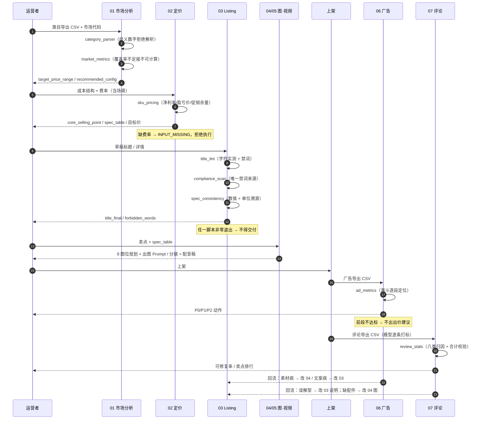

# 架构与数据流

> 一句话：**规则集中、数字集中、算术下沉、判断上浮。**

[← 返回 README](../README.md)

---

## 1. 为什么分两层

TikTok Shop 运营的日常输出有两类内容，混在一起做就会互相污染：

| 内容类型 | 例子 | 出错的后果 | 该谁做 |
|---|---|---|---|
| **确定性算术** | 标题几个字符、净利率几%、这段口播几秒、CR3 多少 | 算错 = 亏钱、违规、被平台下架 | 脚本 |
| **语义判断** | 这个词算核心词还是风险词、这条差评是误解型还是质量问题 | 判断错 = 方向错，但可复盘、可迭代 | 模型 |

如果把算术交给模型：结果是「看起来对」的数字，无法复现、无法测试、无法解释。
如果把判断交给脚本：需要穷举语义规则，维护成本爆炸。

所以本项目每个环节都是 **`prompts/` 与 `scripts/` 并列**，脚本先跑，产物喂给模型，模型只在脚本给出的数字上做解读。

```
输入 ──→ [脚本层] ──→ 确定性数字 ──┐
                                  ├──→ [模型层] ──→ 结论 / 动作
模板 ──→ 规则（core/） ───────────┘
```

---

## 2. 分层结构

```
┌──────────────────────────────────────────────────────────────┐
│  入口层    SKILL.md（路由 + 三条底线）                          │
│            runbook.md（执行顺序 + 停止条件）                    │
├──────────────────────────────────────────────────────────────┤
│  规则层    core/compliance.json      6 类禁词库（唯一来源）      │
│            core/language-units.md    5 市场语言 / 单位 / 当地坑  │
│            core/handoff.md           模块间字段契约             │
├──────────────────────────────────────────────────────────────┤
│  数据层    markets/{us,uk,th,vn,id}.json   平台数字（唯一来源）  │
│            lib/market_config.py            读取 + 校验          │
├──────────────────────────────────────────────────────────────┤
│  执行层    modules/01…07                                        │
│              ├── SKILL.md    入口 + 停止条件                    │
│              ├── scripts/    确定性算术（零依赖）                │
│              ├── prompts/    模型任务（22 个）                   │
│              └── templates/  输入模板（7 个）                    │
├──────────────────────────────────────────────────────────────┤
│  验证层    tests/run_asserts.py      10 组断言                  │
│            tests/fixtures/           故意混口径的脏样例         │
└──────────────────────────────────────────────────────────────┘
```

**依赖方向严格向下**：执行层可以读规则层和数据层，规则层不依赖任何东西。所以改一个市场数字，不需要动任何脚本。

---

## 3. 数据流：一次完整的闭环



---

## 4. 字段级契约

模块串联最容易出的问题是**参数漂移**：上游定 200 kg，下游做成 150 kg。

`core/handoff.md` 把归属钉死，只允许一个方向：

```yaml
# 02 → 03 / 04 / 05
core_selling_point: ""        # 一句话，必须能用 spec_table 里至少一个数字支撑
secondary_points: []          # 3–5 条
spec_table: {}                # 参数 → 值（带单位）  ← 人工录入，唯一数值来源
usage_scope_confirmed: []     # 允许表达的使用场景
forbidden_words: []

# 03 → 04 / 05
title_final: ""
visual_tone_hint: ""
package_content: []           # 必须含「不含什么」
```

三条硬规则：

| 规则 | 防住的事故 |
|---|---|
| `spec_table` **人工录入**，不进模型 | 模型会把 `45 W` 读成 `45 km`（旧版实测出现过） |
| `core_selling_point` 只归 02，03 **不得改写** | 否则变成「写手决定卖什么」而不是「产品决定卖什么」 |
| 03 发现卖点与 `spec_table` 冲突 → **停下来报错** | 不许自行改规格，不许悄悄对齐文案 |

---

## 5. 唯一来源原则

同一个事实只存一处，改规则只改一个文件。

| 事实 | 唯一来源 | 消费者 |
|---|---|---|
| 禁词 | `core/compliance.json` | `title_lint.py`、`compliance_scan.py`、模型层 |
| 平台数字（标题上限 / 币种 / 认证） | `markets/<m>.json` | 全部脚本 + prompt |
| 每个市场的语言与单位 | `core/language-units.md` | 03 / 04 / 05 的 prompt |
| 模块间字段归属 | `core/handoff.md` | 02 / 03 / 04 / 05 |
| 费率 | **不进库** | 每次调用当场填（类目差异大，写死即错） |

**反例（旧版踩过）**：禁词在 3 个 prompt 里各抄了一份，改了一处另外两处忘了，导致扫描报「无命中」但标题里仍有 `free shipping`。

---

## 6. 停止条件驱动

每个 `SKILL.md` 都有明确的停止条件，脚本用**退出码**实现：

| 脚本 | 非零条件 |
|---|---|
| `category_parser.py` | 数字口径有歧义且未指定 `--number-locale` |
| `market_metrics.py` | 主体数不足导致集中度不可计算（输出警告，不伪造 100%） |
| `sku_pricing.py` | 缺佣金率 / 支付费率 / 市场配置为 `null` |
| `title_lint.py` | 超字符上限 / 命中禁词 |
| `compliance_scan.py` | 命中任一禁词分组 |
| `spec_consistency.py` | 文案数字无法溯源，或数值相同但单位不符 |
| `ad_metrics.py` | 缺必填列 / 认不出列名 |

这是把「经验判断」变成「机器闸门」：**人可以不遵守流程，但 CI 会拦住**。

---

## 7. 为什么 04 模块没有脚本

迁移自老平台时，04 原本有一整套图片规格校验：最小尺寸、白底、无文字、比例。

TikTok Shop **不限最小尺寸、不限背景、主图可以带文字**。继续保留校验器会制造两条假规则：写得越像真的，越误导人。

所以 04 **主动删掉脚本**，只剩规划与出图 Prompt，唯一的机器校验是「图内数字必须逐字符等于 `spec_table`」，这条复用 03 的 `spec_consistency.py`。

> 结论：**没有硬规格时不造规格。** 少一个脚本，比多一个假规则好。

---

## 8. 扩展一个新市场

1. 复制 `markets/us.json` → `markets/<new>.json`，填 `title.max_chars`，其余保持 `null`
2. 在 `core/language-units.md` 加一行语言 / 单位 / 当地坑
3. `python3 lib/market_config.py --check <new>` 应报缺项 —— 这是正确行为
4. 去卖家中心查到真实数字后填入，重跑 `--check` 变 ✅

**不需要改任何脚本、任何 prompt。** 这是数据层存在的全部理由。

---

[← 返回 README](../README.md) ｜ [执行手册 →](../runbook.md)
